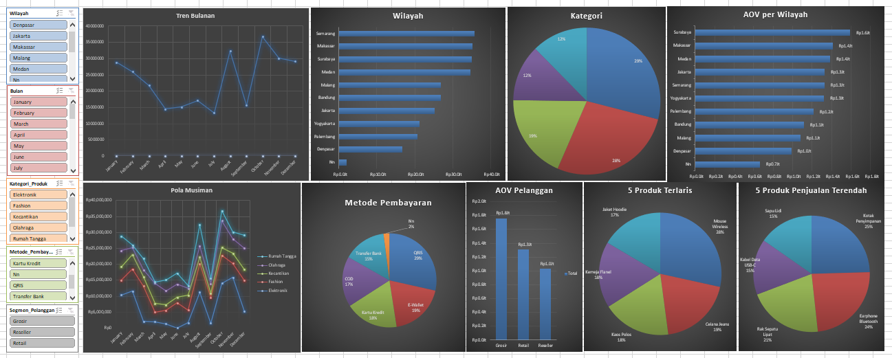
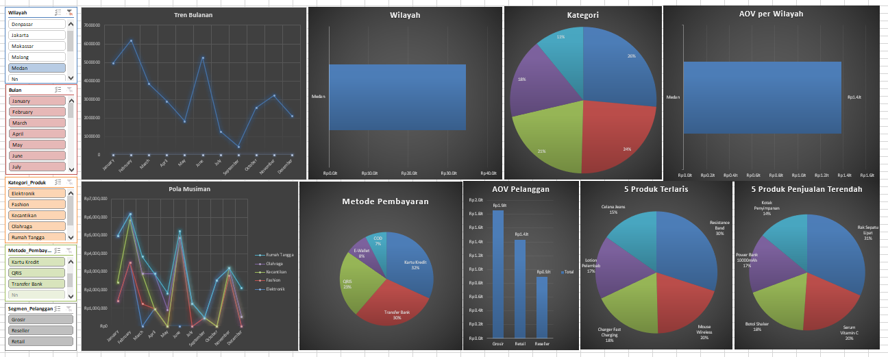
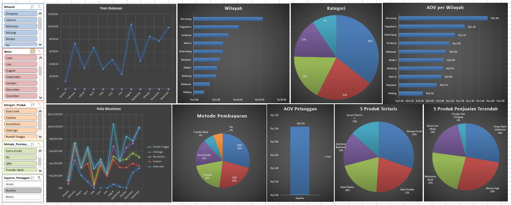
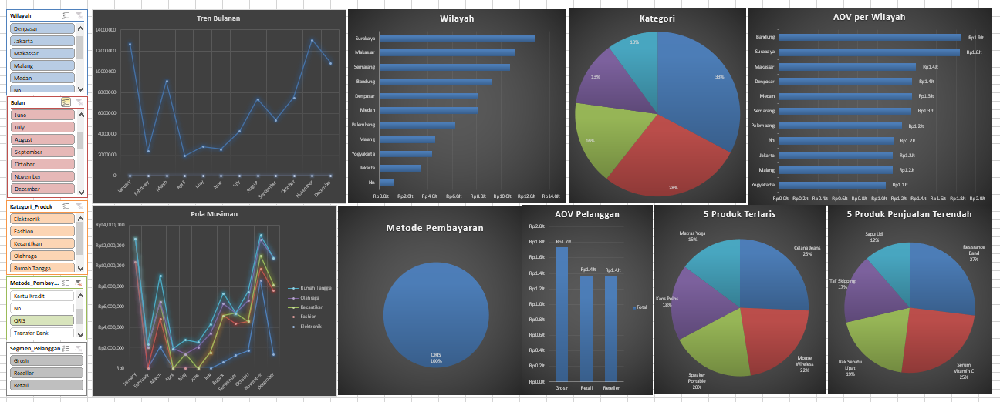
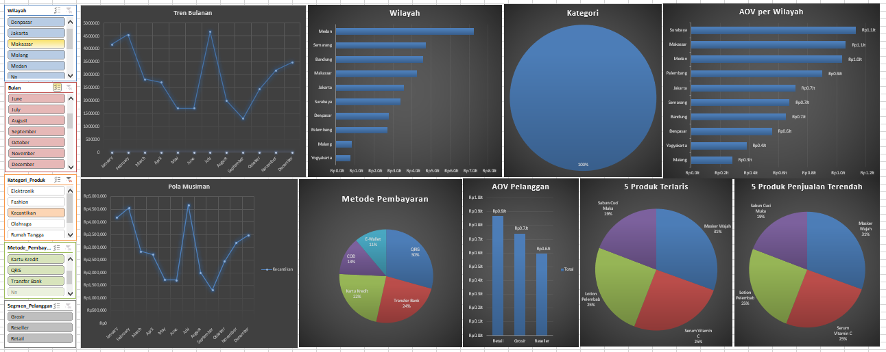
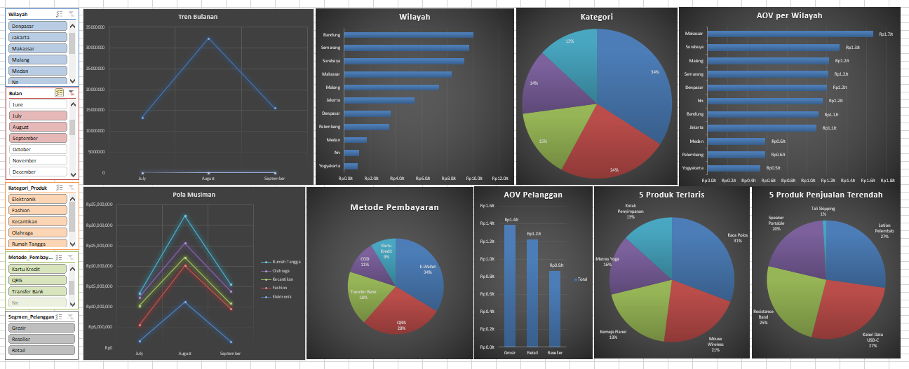

# sales-analysis-excel-pivot-table
Analisis Data Penjualan Menggunakan Excel(Pivot Table)

# Analisis Penjualan XXX Mart

## Latar Belakang
Project ini merupakan project analisis data dengan meggunakan excel(pivot table).
data yang digunakan adalah data penjualan XXX Mart tahun 2025 yang berisi transaksi penjualan, produk,
kategori produk, segment pelanggan, wilayah (kota), metode pembayaran.
Analisis dilakukan untuk mempratikan kemampuan data analisi menggunakan excel, mulai dari data cleaning, pivot table dan dasboard. Analisis ini bertujuan untuk mengatahui pola penjualan, tren analisis, pola musiman, produk terlaris dan produk kurang diminati, wilayah yang memberikan kontribusi penjualan yang besar, kategori produk terlaris, kombinasi kategori produk dan wilayah yang paling menguntungkan bagi perusahaan, metode pembayar yang banyak digunakan serta, segmen pelanggan yang berkontribusi dalam penjualan tertinggi serta memberikan rekomendasi yang dapat mendukung keputusan bisnis.

## Pertanyaan Bisnis
- Tren penjualan per bulan (Januari - Desember).
- Penjualan per wilayah (diurutkan dari terbesar ke terkecil dengan persentase kontribusi masing-masing wilayah).
- 5 Produk terlaris dan 5 produk penjualan terendah.
- Rata-rata nilai transaksi (average order value) antar segmen pelanggan yakni Retail, Reseller dan Grosir.
- Metode pembayaran yang paling banyak digunakan dan apakah ada pengaruh hubungan antara metode pembayaran dengan besarnya nilai transaksi.
- Indefikasi pola musiman, apakah ada kategori prosuk tertentu yang mengalami lonjakan penjualan pada bulan-bulan tertentu.
- kelompokan 10 wilayah dengan pennjualan "Tinggi", "Sedang", Rendah.
- Kombinasi Wilayah X Kategori yang paling menguntungkan.

## Dataset
- Sumber: AI
- Jumlah baris: 224
- kolom utama: Order_ID, Tanggal_Order, Wilayah, Kategori_Produk, Nama_Produk, Jumlah, Harga_Satuan, Total_Penjualan, Metode_Pembayaran, Segmen_Pelanggan

## Tools & Teknik
  - Microsoft Excel
  - Data Cleaning (Remove Duplicates, Rename null data yang memiliki nilai transaksi)
  - Pivot table + Pivot Chart
  - Formula: SUM, MIN, MAX, AVERAGE, COUNT, INDEX, TEXTJOIN
  - Dashboard: Microsoft Excel (sheet Presentasi)

## Hasil Dashboard

## Insight Utama
1. Fashion & Elektronik mendominasi 56,5 % total penjualan. Elektronik dengan AOV tertinggi tapi sangat musiman.
2. 4 kota menyumbang 50% merata yakni Semarang, Makassar, Surabaya, Medan, tidak ada dominasi ekstreme di salah satu kota.
3. Reseller dengan AOV lebih rendah dari Retail Rp1,03 Jt vs Rp1,31 Jt.Hal ini berlawanan dengan pola bisnis wajar.
4. Mouse Wireless mendominasi sendirian 50% lebih tinggi dari produk terlaris ke-2 sehingga beresiko pada konsentrasi produk.
5. QRIS metode pembayaran terbesar 28,5% dari total, menyebabkan pergeseran yang kuat ke pembayaran digital.

## Rekomendasi Strategis 2026
1. Reseller Salah Perilaku: AOV < Retail. AOV Reseller (Rp1,03 Jt) di bawah Retail (Rp1,3Jt), padahal seharusnya Reseller membeli lebih banyak. Perlu terapkan MOQ/tiered pricing khusus Reseller (1 bulan).
2. Elektronik Meledak di Q4 tapi kosong di Q2. Melonjak 2,5x di bulan November, tapi nyaris kosong di Maret - Juli. Perlu dilakukan kampanye elektronik di Q2  untuk meratakan permintaan .
3. 3 Kota Rendah, perlu dilakukan diagnosis terlebih dulu yakni Yogyakarta, Palembang, Denpasar hanya 21% gabungan. Lakukan riset lapangan sebelum melakukan alokasi budget.
4. Mouse Wireless Dominan Sendirian, rata-rata 50% lebih tinggi dari produk terlaris  ke-2  yang berisiko konsentrasi pada satu produk. Lakukan bundling dengan Kabel Data USB-C/Earphone Bluetooth.
5. QRIS Dominan, Perlu Prioritaskan Infrastruktur, 28,5% transasksi via QRIS, jauh diatas Transfer Bank (14,8%). Audit biaya dan settlement QRIS selama 1 bulan.
6. Kotak Penyimpanan laris tapi Harga Murah, 153 produk terjual tapi termasuk dalam penjualan yang terendah karena masalah harga bukan permintaan. Lakukan riset lapangan sebelum melakukan alokasi budget.

## File
- [Dataset](Data_mentah.xlsx)
- [Hasil Analisis](Hasil_Analisis.xlsx)

